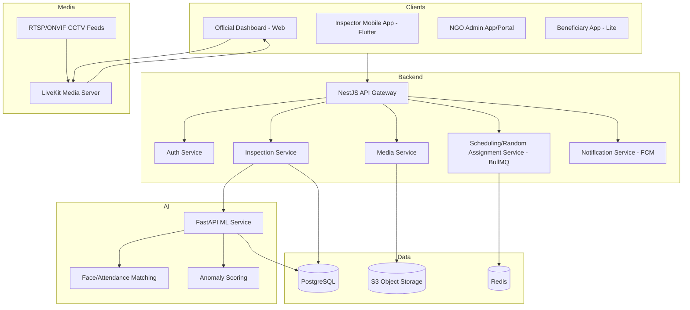

# Smart Real-Time Monitoring & Inspection Mobile App — Build Specification
**For: DoSJE Scheme Monitoring | Target: AI-assisted development (GitHub Copilot / Claude Code)**

> Feed this document to Copilot Chat / Copilot Workspace section by section (or as a whole) as the project brief. Each module below is scoped so it can be built and tested independently before integration.

---

## 1. Project Overview

**Goal:** Build a mobile-first platform that lets DoSJE (Department of Social Justice & Empowerment) monitor projects/institutes/NGOs in real time through CCTV feeds, randomized virtual inspections, geo-tagged field inspections, and AI-based anomaly detection — to reduce fake reporting and improve governance.

**Primary users:**
- **Inspector / PMU Team** — mobile app, does field inspections
- **Department Official** — web + mobile dashboard, monitors everything
- **NGO/Institute Admin** — registers site, cameras, staff, beneficiaries
- **Beneficiary** — minimal app/portal, attendance & feedback only
- **State/District Authority** — read-only oversight dashboard

---

## 2. Recommended Tech Stack (be explicit with Copilot about this — don't let it guess)

| Layer | Choice | Why |
|---|---|---|
| Mobile app | **Flutter** (Dart) | Single codebase, strong camera/GPS/background-service support |
| Backend API | **Node.js + NestJS + TypeScript** | Modular, good for RBAC-heavy govt systems |
| Primary DB | **PostgreSQL** | Relational integrity for users, schedules, audit logs |
| Media/reports store | **S3-compatible object storage** (MinIO for self-host / AWS S3 / NIC cloud) | Photos, videos, reports |
| Real-time video | **LiveKit** or **Ant Media Server** (self-hosted) for CCTV transcode + WebRTC delivery | Open-source, ONVIF/RTSP compatible |
| Video conferencing | **LiveKit** (same infra) or **Jitsi Meet SDK** | Avoids per-minute vendor lock-in |
| Push notifications | **Firebase Cloud Messaging (FCM)** | Standard for Flutter |
| Background jobs / scheduler | **BullMQ (Redis-backed)** | For random assignment + random VC triggers |
| AI/ML services | Separate **Python (FastAPI) microservice** using OpenCV + a pretrained face-recognition model (e.g., InsightFace) and a simple anomaly-scoring model | Keep ML isolated from main API for easier iteration |
| Auth | **JWT + refresh tokens**, OTP login via SMS gateway; Aadhaar e-KYC only if mandated later | Start simple, add compliance layer later |
| Infra | Docker Compose for dev; Kubernetes for production; deploy on NIC/MeghRaj empanelled cloud for compliance | |

---

## 3. High-Level Architecture



---

## 4. Data Models (give this to Copilot as-is for the Prisma/TypeORM schema)

```
User
  id, name, role[Inspector|Official|NGOAdmin|Beneficiary|Authority],
  phone, email, passwordHash, institute_id (nullable), district, state,
  createdAt, isActive

Institute
  id, name, type[Project|Institute|NGO], schemeType, address,
  lat, lng, contactPerson, status[Active|Flagged|Suspended],
  registeredCameras: Camera[]

Camera
  id, institute_id, rtsp_url, label, status[Online|Offline|Tampered],
  lastPingAt

InspectionAssignment
  id, inspector_id, institute_id, scheduledAt, status[Pending|InProgress|Completed|Missed],
  assignmentType[Random|Manual|Triggered], riskScoreAtAssignment

InspectionReport
  id, assignment_id, checklistResponses (JSON), photos: Media[],
  videos: Media[], gpsLat, gpsLng, gpsAccuracyMeters, submittedAt,
  flaggedAnomalies: Anomaly[]

Media
  id, report_id, type[Photo|Video], s3_key, capturedAt, gpsLat, gpsLng,
  deviceHash, isTampered(bool)

VCSession
  id, institute_id, initiatedBy, participants[], startedAt, endedAt,
  recordingUrl (nullable), triggerType[Random|Manual]

Anomaly
  id, source[Report|VC|CCTV|Attendance], institute_id, description,
  severity[Low|Medium|High], detectedAt, resolvedStatus

AttendanceLog
  id, institute_id, person_id, personType[Staff|Beneficiary],
  method[FaceMatch|Manual], matchConfidence, timestamp
```

---

## 5. Core Modules & Build Order (build and test each before moving on)

### Module 1 — Auth & RBAC
- OTP-based login, JWT issuance, role-based route guards in NestJS.
- Flutter: login screen, token storage (flutter_secure_storage), role-based navigation.
- **Copilot prompt starter:** *"Create a NestJS auth module with OTP login, JWT + refresh token, and role-based guards for roles Inspector, Official, NGOAdmin, Beneficiary, Authority."*

### Module 2 — Institute & Camera Registration
- CRUD APIs for institutes and cameras.
- Admin web form to register RTSP URLs.
- **Copilot prompt starter:** *"Create a NestJS CRUD module for Institute and Camera entities using TypeORM/Prisma with PostgreSQL, including validation for RTSP URL format."*

### Module 3 — Mobile Inspection Module (build this first on the Flutter side — it's the MVP core)
- Dynamic checklist form renderer (JSON-driven, so forms can change per scheme without app updates).
- Camera capture screen that: takes photo/video → stamps GPS + timestamp overlay → checks device is within X meters of institute's registered lat/lng → uploads to S3 via presigned URL.
- Offline queue: store submissions locally (Hive/SQLite) and sync when online.
- **Copilot prompt starter:** *"Create a Flutter screen that captures a geotagged photo, overlays GPS coordinates and timestamp on the image, validates the device is within 100 meters of a given lat/lng, and queues the upload for background sync using Workmanager."*

### Module 4 — Random Assignment Engine
- BullMQ scheduled job runs daily/weekly.
- Weighted-random algorithm: inputs = days since last inspection, institute risk score, inspector availability/location.
- Writes an immutable audit log entry for every assignment (append-only table, no updates allowed) so assignment can't be manually altered after the fact.
- **Copilot prompt starter:** *"Write a NestJS service using BullMQ that runs a scheduled job to randomly assign inspectors to institutes using a weighted-random algorithm based on last-inspection-date, risk score, and inspector proximity. Log every assignment to an append-only audit table."*

### Module 5 — Real-Time Dashboard (Web, React + TypeScript)
- Map view (Leaflet or Mapbox) with institute pins colored by status.
- Live inspection feed list, filters by district/scheme/status.
- **Copilot prompt starter:** *"Create a React dashboard page with a Mapbox map showing institute markers colored by compliance status, and a side panel listing live/recent inspections fetched from a REST API."*

### Module 6 — CCTV Integration
- Backend service pings camera RTSP URLs for health status.
- LiveKit/Ant Media ingests RTSP → serves as WebRTC/HLS to dashboard and mobile.
- **Copilot prompt starter:** *"Set up an Ant Media Server Docker config that ingests an RTSP stream and re-streams it as HLS, plus a NestJS health-check service that pings camera endpoints every 5 minutes and updates status in PostgreSQL."*

### Module 7 — Random VC Module
- Scheduler picks random institute + random staff/beneficiary.
- Sends FCM push → both sides join a LiveKit room.
- Session gets logged with optional recording (only where legally permitted).
- **Copilot prompt starter:** *"Create a NestJS service that randomly selects an institute and triggers a LiveKit video call by sending FCM notifications to the relevant Flutter app users, then logs the session start/end time."*

### Module 8 — AI Services (Python/FastAPI, separate service)
- Face-matching endpoint for attendance (compare captured face to registered photo).
- Simple anomaly scoring: flag institutes where CCTV goes offline right before a scheduled inspection, or where attendance count deviates significantly from claimed numbers.
- **Copilot prompt starter:** *"Create a FastAPI service with an endpoint that accepts two images and returns a face-match confidence score using InsightFace, plus a second endpoint that scores anomaly risk given a JSON of institute activity logs."*

---

## 6. Suggested Repo Structure

```
dosje-monitoring/
├── apps/
│   ├── mobile/              # Flutter app
│   ├── dashboard/           # React web dashboard
│   └── api/                 # NestJS backend
├── services/
│   └── ai-service/          # FastAPI ML microservice
├── infra/
│   ├── docker-compose.yml
│   └── k8s/
├── docs/
│   └── DoSJE-Monitoring-App-Spec.md   # this file
└── README.md
```

---

## 7. Suggested Build Phases (matches Module order above)

1. **Phase 1 (MVP, ~4-6 weeks):** Auth, Institute registration, Mobile Inspection module with geo-tagged capture, basic dashboard.
2. **Phase 2:** Random assignment engine, offline sync, push notifications.
3. **Phase 3:** CCTV integration (health checks + live view).
4. **Phase 4:** Random VC module.
5. **Phase 5:** AI face-match attendance + anomaly scoring.

---

## 8. Non-Functional Requirements to Tell Copilot Up Front

- All GPS/photo evidence must be **non-editable after submission** (store original file hash to detect tampering).
- Every write to `InspectionAssignment` must be **append-only** / audit-logged — no silent updates.
- Design for **low-bandwidth conditions**: compress images before upload, allow HLS at multiple bitrates, offline-first mobile app.
- Data privacy: beneficiary personal data must be access-controlled by role; plan for DPDP Act (India) compliance.
- Target hosting: NIC/MeghRaj empanelled cloud or equivalent government-approved infrastructure.

---

## 9. How to Use This With Copilot

1. Paste **Section 2 (Tech Stack)** and **Section 4 (Data Models)** into a new repo's `docs/` folder first — this gives Copilot consistent context across sessions.
2. Work module by module (Section 5), pasting each module's prompt starter into Copilot Chat inside the relevant app folder so it has the right file context.
3. After each module, ask Copilot to generate tests before moving to the next — this catches integration issues early, which matters a lot given the audit/compliance requirements here.
